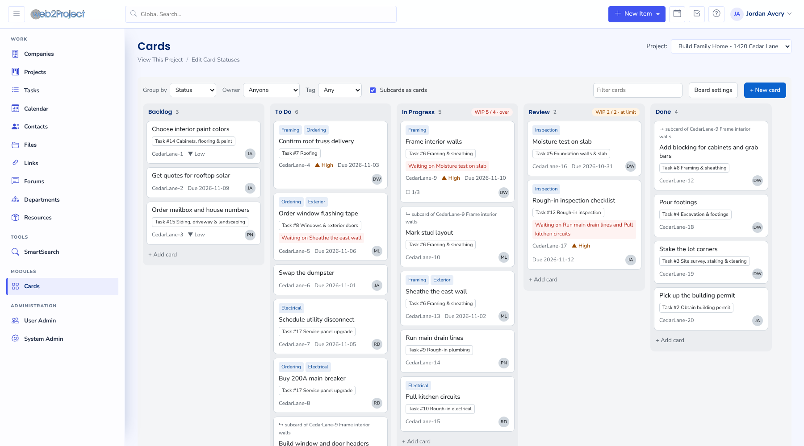

# Cards for web2project

A Kanban board module for web2project 5: cards you drag between columns,
attached to a project and optionally to one of its tasks.

- **All projects board** (the default) with every card you may see, and a
  **board per project**. Columns come from a global status list. Drag cards
  between columns and within them; the order is kept per project.
- **Group by** status, priority, owner, tag, and linked task (project board)
  or project (all projects board). Dropping a card in another column sets
  that field.
- **Status filter**: the toolbar's **Status** menu picks which statuses you
  see, in any grouping. **Open** hides the closed statuses (like Done) to
  show what's left; **Closed** shows only those, to see what's finished.
  Each board remembers your choice in your browser. The task view's Cards
  tab has the same choice under **Show**.
- **Card drawer**: name, status, priority, owner, due date, linked task,
  tags, description, subcards, dependencies, and the card's activity log
  with comments. Type several tags at once, separated by commas
  ("electrical, rough-in"). Close the drawer with ×, Escape, or a click
  outside it.
- **Subcards and dependencies** between cards of the same project, with loop
  detection.
- **Copy a card** (the drawer's **Copy card…**): a deep copy of the card,
  all its subcards and their dependencies. See [Copying cards](#copying-cards).
- **Move to another project** (the drawer's **Move to…**, next to the
  project): moves the card with its subcards and, if you choose, the cards
  connected to it by dependencies. See
  [Moving a card to another project](#moving-a-card-to-another-project).
- **Repeating cards**: copy a card on a schedule, such as every Monday or
  on the 1st of each month. See [Repeating cards](#repeating-cards).
- **Soft WIP limits** per board: a column header turns amber at its limit
  and red above it. Moves are never blocked.
- **Cards tab** on the project view (a compact board) and on the task view
  (the task's cards, plus its sub-tasks' cards marked "via sub-task").
- **Activity log** (`card_activity`) of every change, kept with the card.
- **Smart Search** finds cards by name and description, and the **Calendar**
  (month, week and day views, and your calendar feed) shows your open cards
  on their due dates.

Cards are stored on their own; they don't change web2project tasks. See
modules-cards #1 for how cards relate to tasks.



More in [screenshots/](screenshots/README.md), one for each wireframe.

## Requirements

- web2project 5 (built against the `dev-5.0.0` branch)
- PHP 8.1 or later
- MySQL or MariaDB (the module's own tables use InnoDB)

## Install

The module is the `cards/` folder of this repository. It goes into
web2project's `modules/` folder, still named `cards`. Copy it:

```bash
git clone https://github.com/caseysoftware/modules-cards.git
cp -R modules-cards/cards /path/to/web2project/modules/cards
```

or link it, so a `git pull` updates the module:

```bash
ln -s "$(pwd)/modules-cards/cards" /path/to/web2project/modules/cards
```

(With Apache, symlinks need `Options +FollowSymLinks`, which web2project's
`.htaccess` already sets.)

Then, as an administrator:

1. **System Admin → View Modules**: find **Cards**, click **install**, then
   switch it **active** (and visible in the menu).
2. Log out and back in. web2project caches the list of tabs per session, so
   the **Cards** tabs on project and task views appear after a new login.
3. Give roles access in **System Admin → Roles** if they don't get it
   through "non-admin modules" already.
4. Make sure `queuescanner.php` runs from cron (for example every 15
   minutes). The module's consistency sweep runs there; see below.

Removing the module from System Admin drops its tables and all cards.

## Permissions

A user sees a card when they
may view the **Cards** module, may view the card's **project**, and (if the
card is linked to a task) may see that **task**: the task permissions plus
the task's access level (public, protected, participant, private), the same
rules as the task view. If a user can't see a task, they don't see the cards
attached to it.

Adding, changing and deleting cards needs the **add**, **edit** and
**delete** rights on the Cards module. Board settings need edit rights on
the project. The default board settings and the global status list need
System edit rights.

The same rules apply everywhere: the boards, the tabs, Smart Search, the
calendar, and core lookups of single cards (History). Per-card denials set
in Roles also apply, but they can't grant a card whose project or task the
user can't see.

## Statuses, settings and keys

- **Statuses** are one global list (**Cards → edit card statuses**). Each
  status "counts as" not started, started or closed. A status that still has
  cards can't be removed.
- **Board settings** are per project: which status columns are shown, soft
  WIP limits, and which fields cards show.
- **Default board settings** (administrators, from the all projects board's
  **Default settings** button) are what the all projects board uses, and
  what every project uses until it saves settings of its own. Once a project
  saves its settings it keeps them. The all projects board shows no WIP
  limits: those belong to one team's board.
- **Card keys** look like `CedarLane-42`: the project's short name and the
  card's id. They are display only; everything links by id, so a key keeps
  working after the project's short name changes or the card moves to
  another project (the number never changes).

## Copying cards

**Copy card…** in the drawer copies the card and every subcard under it, in
the same project. You name the top copy and can give all copies one status
(say, **To Do** when copying last week's list) or keep each card's status.

- Copied: name, description, priority, owner, due date, linked task, tags,
  and the tree of subcards. Not copied: comments and the activity log; each
  copy's log starts with "created this card as a copy of …", and the
  original logs the copy.
- Dependencies between cards in the copy are recreated between the copies.
  When a copied card waits on a card outside the copy, its copy waits on the
  same card. Cards outside the copy that wait on an original are left alone.
- The copy sits right after the original, under the same parent; copying a
  subcard gives its parent another subcard.
- Subcards you can't see aren't copied (nor anything under them), and
  neither are dependencies on cards you can't see. The confirmation says
  how many were left out.
- Needs the Cards **add** right. A copy can hold at most 500 cards.

## Repeating cards

A card can repeat: on each date of its schedule, it's copied the same way
as **Copy card…** (with its subcards, tags and dependencies). Use it for a
weekly checklist or a monthly report: keep the original as the template,
for example in a status you hide from the board.

Set it up from the drawer's **Repeat** section:

- **How often**: every week on chosen days, every month on a day (29 to 31
  fall on the last day of shorter months), or every N days.
- **Starting**: the first date; it can't be in the past.
- **Name of each copy**: `{name}` is the card's name, `{date}` the copy's
  date ("Nov 9"), `{iso}` the date as 2026-11-09, `{week}` the ISO week
  number, `{month}` and `{year}`. The default is `{name} – {date}`.
- **Status of the copies**, or keep each card's status.
- **Move due dates with each copy**: the original's due dates are for the
  first copy; each later copy moves them by the number of days since then.
- **Skip a copy while the last one is still open**.

How it runs:

- Copies are made by date, not at a set time: on the first cron run
  (`queuescanner.php`) on or after the date, or the first time someone
  loads a board, whichever comes first. Dates are the web2project server's.
- Missed dates aren't made up: if nothing ran for three weeks, the next run
  makes one copy and the schedule moves on to the next date after today.
- Two runs at once can't make the same copy twice.
- A repeat runs as the user who last saved it, with that user's rights at
  the time of each run. If they can no longer see the card or add cards,
  the repeat pauses, and the drawer and activity log say why. Saving it
  again resumes it as you.
- The board marks repeating cards with ↻. Saving, skipping, pausing and
  stopping are all in the card's activity log. Deleting the card deletes
  its repeat.
- Setting up a repeat needs the Cards **add** and **edit** rights.

## The all projects board

**Cards** opens on **All projects**: every card you may see in an **active**
project, grouped by project within each column. Each card shows its title with the due date
on the right, and its project as a pill in the project's color with the
subcard count on the right; card numbers aren't shown there. You can drag
cards between statuses (and priorities, owners and tags), but never between
projects: grouped by project, a card can only be reordered within its own
project's column. **+ New card** asks which project the card is for. Pick a
project in the title bar for a single project's board; the picker lists
**All projects** and the active projects. An inactive project's board is
still reachable from its project's **Cards** tab or a link to one of its
cards, and then shows in the picker marked "(inactive)".

### Moving a card to another project

Cards can't be dragged between projects. Instead, open the card and use
**Move to…** next to its project:

1. Pick another **active** project you can see. The dialog lists every card
   that will move: the card and all its subcards and, when the card has
   any, the cards connected to them by dependencies (in either direction,
   through any number of links, each with its subcards). That last part is
   on by default; untick it to move only the card and its subcards.
2. **Continue…** shows what the move breaks and asks you to confirm:
   - **Task links are removed** from every card that moves, because tasks
     belong to the old project. The list names each card and its task.
   - Dependencies between a card that moves and one that stays are removed.
   - A moved card whose parent card stays becomes a top-level card.

The cards keep their ids, comments, tags, activity and repeats, and their
order, at the end of the new project's board. Keys take the new project's
short name (`CedarLane-42` becomes `Shed-42`). Every change is logged on
the cards involved, on both sides of a removed link, and the move shows in
the project's History.

Moving needs the Cards **add** and **edit** rights. If any card that would
move is on a task you can't see, the move is refused: clearing its task
would show it to everyone in the new project. A move can take at most 500
cards. If the cards that would move change between the dialog and the
confirmation (someone adds a dependency, say), nothing moves and you're
asked to look again.

A card also changes project with its linked task: when a task moves to
another project in its task form, its cards follow (see below).

## Consistency with tasks and projects (modules-cards #3)

- A **project** is deleted → its cards are deleted.
- A **task** is deleted → the cards linked to it are deleted, with their
  subcards.
- A task is **moved to another project** (web2project moves its subtasks
  too) → the cards on those tasks move with them, with their subcards. Any
  subcard link or dependency that would now cross projects is removed and
  logged on both cards. Each move is logged.
- Otherwise, cards change project only through **Move to…**, and
  relationships only connect cards in the same project.

These run in the cron sweep (`CCard::hook_cron`, from `queuescanner.php`).
Until the sweep runs, the board already shows the right thing ("validate
links on read"): cards on a deleted task or project are hidden, and cards
on a moved task show under the task's new project. When web2project can tell
modules about task and project changes (web2project/web2project#526), the
same handlers will run immediately; the sweep stays as a backstop.

## Development

Everything below is inside `cards/`.

```
cards.class.php           CCard: module main class; search, calendar and cron hooks
setup.php                 install, remove, upgrade
index.php                 the board: all projects or one project
statuses.php              global status list (admins)
do_card_json.php          JSON endpoint used by the board
do_statuses_aed.php       saves the status list
projects_tab.view.cards.php, tasks_tab.view.cards.php   the tabs
includes/                 CardStore (writes), CardBoard (reads), CardAccess
                          (permissions), CardMaintenance (sweep),
                          CardSchedules (repeating cards), CardRank,
                          CardActivity, CardTags, CardStatuses, CardSettings,
                          CardJson, CardView
assets/                   board.js, board.css, vendor/Sortable.min.js
tests/                    rank_test.php, schedule_test.php, api_test.py,
                          allview_test.py, move_test.py, ui_test.py,
                          schedule_run_test.py, sweep_test.py
```

The board is plain JavaScript (no build step) plus SortableJS. It posts to
`do_card_json.php` with the session's form token; every change answers with
the refreshed board, which is rendered again. Card text is always inserted
as text, never as HTML. Changes carry the card's version, and a stale change
gets a 409 with the current board.

Card order uses fractional ranks (`includes/CardRank.php`): a drop writes
one row. Ranks are rebalanced per project when they grow long.

### Tests

The Python tests run against a web2project instance with its demo data
(`dev/demo-data/setup.sh` in web2project) and the module installed and
active. They need `requests`, `playwright` (with Chromium) and the `mysql`
client. Run them from the `cards/` folder:

```bash
cd cards
php tests/rank_test.php
php tests/schedule_test.php
python3 tests/api_test.py
W2P_DIR=/path/to/web2project python3 tests/allview_test.py   # after api_test.py
W2P_DIR=/path/to/web2project python3 tests/move_test.py
python3 tests/ui_test.py --shots /tmp/shots
W2P_DIR=/path/to/web2project python3 tests/schedule_run_test.py
W2P_DIR=/path/to/web2project python3 tests/sweep_test.py   # run last: it moves and deletes demo tasks
```

## Not in this version yet

- Swimlanes (wireframe 2).
- Real-time handling of task and project changes: waits on
  web2project/web2project#526 (the cron sweep covers it meanwhile).
- Tags are module-local (`card_tags`) until core tagging
  (web2project/web2project#529); the JSON helper is module-local until
  web2project/web2project#528.
- Markdown in descriptions and comments (modules-cards #2).
- Dragging with the keyboard; the drawer's Status menu moves a card without
  a mouse.
- Long Done columns are not paged.
- The calendar shows the cards you own; there's no option yet to show
  everyone's.

## Upgrading

Copy the new `cards/` folder over the installed one (or `git pull` a
linked install), then **System Admin → View Modules → upgrade** on Cards.

- 0.4.2 (repeat dialog title, calendar feed titles without the card key)
  has no database changes.
- 0.4.1 (Move to another project) has no database changes; the upgrade
  only records the new version.
- 0.4.0 adds the `card_schedules` table for repeating cards. (The status
  filter in the same release has no database changes.)
- 0.3.0 (comma-separated tags, closing the drawer by clicking outside it,
  deep copy) has no database changes.
- 0.2.0 registers cards as permission items so Smart Search and History can
  check single cards.

## Third-party

`assets/vendor/Sortable.min.js` is [SortableJS](https://github.com/SortableJS/Sortable)
1.15.7, MIT licensed (`assets/vendor/Sortable.LICENSE`).
